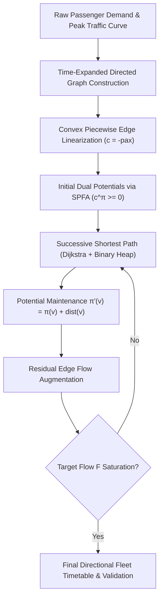

# Algorithm Logic Flow & Theoretical Architecture: Directional Fleet Dispatch Optimization
**Document Purpose**: Viva / Oral Defense & Comprehensive Technical Documentation for Professor & Evaluator Presentation  
**Project**: Directional Fleet Dispatch Optimization for PMPML Hinjewadi $\leftrightarrow$ Swargate Corridor  
**Core Subject**: Design and Analysis of Algorithms (DAA)  

---

## 📑 Table of Contents
1. [High-Level Executive Overview](#1-high-level-executive-overview)
2. [The Real-World Transit Dilemma](#2-the-real-world-transit-dilemma)
3. [Graph Model: The Time-Expanded Directed Network](#3-graph-model-the-time-expanded-directed-network)
4. [Mathematical Formulation: Revenue Linearization & Convexity](#4-mathematical-formulation-revenue-linearization--convexity)
5. [The Core Algorithm: Successive Shortest Path with Potentials](#5-the-core-algorithm-successive-shortest-path-with-potentials)
   - [Phase A: SPFA for Initial Dual Feasibility](#phase-a-spfa-for-initial-dual-feasibility)
   - [Phase B: Dijkstra Augmentation with Reduced Costs](#phase-b-dijkstra-augmentation-with-reduced-costs)
   - [Phase C: Potential Updates & Residual Flow Augmentation](#phase-c-potential-updates--residual-flow-augmentation)
6. [Step-by-Step Execution Walkthrough (A Bus's Journey Through the Graph)](#6-step-by-step-execution-walkthrough)
7. [Serial vs Parallel OpenMP Architecture](#7-serial-vs-parallel-openmp-architecture)
   - [Serial C Memory Layout & Execution Pipeline](#serial-c-memory-layout--execution-pipeline)
   - [Parallel OpenMP Strategy & Thread Work-Sharing](#parallel-openmp-strategy--thread-work-sharing)
   - [Amdahl's Law & Granularity Analysis](#amdahls-law--granularity-analysis)
8. [Edge Cases & Boundary Condition Handling](#8-edge-cases--boundary-condition-handling)
9. [Key Takeaways & Formula Sheet for Professor Defense](#9-key-takeaways--formula-sheet-for-professor-defense)

---

## 1. High-Level Executive Overview

When explaining this project to your professor, summarize it in three core pillars:
1. **The Real-World Challenge**: PMPML buses serving the 24 km Hinjewadi $\leftrightarrow$ Swargate route face extreme directional asymmetry (heavy morning inbound to the IT park, heavy evening outbound to the city). A static symmetric timetable wastes buses.
2. **The Algorithmic Transformation**: We convert a complex dynamic scheduling problem into a **Min-Cost Max-Flow (MCMF)** optimization on a **Time-Expanded Directed Graph** $G = (V, E)$, avoiding heuristic approximations.
3. **From-Scratch Engineering**: We implement the solver strictly from scratch (no solver black-boxes) in **Pure Python**, **Sequential C**, and **Parallel OpenMP C**, proving exact mathematical equivalence with Google OR-Tools while demonstrating a **+13.59% passenger gain (+1,173 daily commuters)**.



---

## 2. The Real-World Transit Dilemma

### Spatial and Temporal Asymmetry
- **Morning Commute (07:30 - 10:30)**: Thousands of software engineers travel from Pune central residential hubs (Swargate) into Rajiv Gandhi Infotech Park (Hinjewadi). Demand spikes up to **$500+$ commuters / 30 mins**. In reverse, demand is negligible (~$60$ commuters).
- **Evening Rush (17:00 - 20:30)**: Workers leave Hinjewadi heading back to Swargate. The demand reverses completely (**$550+$ commuters / 30 mins** outbound, ~$70$ inbound).
- **Dynamic Traffic Congestion**: 
  - Off-peak travel time: $\approx 75$ minutes.
  - Peak travel time: $\approx 95 - 120$ minutes due to bottlenecks at Chandani Chowk and Wakad Flyover.
- **Physical Invariant**: A bus that completes a trip at terminal $B$ requires a **10-minute mandatory layover** and can **only** start its next trip from terminal $B$. It cannot magically teleport back to terminal $A$.

### Why Baseline Schedulers Fail
Traditional transit depots run **symmetric headways** (e.g., 1 bus every 10 minutes from both ends). 
- In the morning, Hinjewadi-bound buses are overwhelmed (denied boardings), while Swargate-bound buses run nearly empty.
- When evening arrives, not enough buses are stationed at Hinjewadi to handle the massive outbound rush.

---

## 3. Graph Model: The Time-Expanded Directed Network

To represent space and time simultaneously, we use a **Time-Expanded Network**. Instead of having static nodes for terminals, time is discretized into intervals $\Delta \tau$ (e.g. 30 minutes, 15 minutes, or 10 minutes) across the operating window (06:00 to 22:30, $T$ slots total).

### 3.1 Node Construction
- Each physical terminal at a discrete moment in time is a distinct node:
  $$v(\text{terminal}, t) = \text{terminal} \cdot T + t$$
  - $\text{terminal} = 0 \implies \text{Swargate}$
  - $\text{terminal} = 1 \implies \text{Hinjewadi}$
  - $t \in [0, T-1]$ (e.g. $t = 0$ is 06:00, $t = 1$ is 06:30, ..., $t = 33$ is 22:30).
- **Super-Source ($S^* = 2T$)**: Holds the total initial depot fleet $F$.
- **Super-Sink ($T^* = 2T + 1$)**: Collects all buses at the end of the day.
- **Total Nodes**: $|V| = 2T + 2$. For $T = 34$, $|V| = 70$.

### 3.2 Edge Types & Capacities

```text
    [Super Source S*]
       /          \
  (cap=F_S)     (cap=F_H)
     /              \
    v                v
(Swargate, t=0)    (Hinjewadi, t=0)
    |                     |
[Wait Arc]            [Wait Arc]  (cap=F, cost=0)
    v                     v
(Swargate, t=1) =====> (Hinjewadi, t=arr)  [Trip Arc] (cap=1, cost=-pax)
                      (empty trip: cap=F, cost=0)
    |                     |
   ...                   ...
    v                     v
(Swargate, T-1)    (Hinjewadi, T-1)
       \                /
        \              /  (cap=F, cost=0)
         v            v
        [Super Sink T*]
```

1. **Depot Initialization Edges**:
   - $S^* \to (\text{Swargate}, 0)$ with $\text{capacity} = F_S$, $\text{cost} = 0$.
   - $S^* \to (\text{Hinjewadi}, 0)$ with $\text{capacity} = F_H$, $\text{cost} = 0$.
   - Total flow pushed from $S^*$ to $T^*$ is exactly $F = F_S + F_H$.

2. **Vehicle Holding / Idling Edges (Wait Arcs)**:
   - Connects $(\text{term}, t) \to (\text{term}, t+1)$ for each terminal.
   - $\text{capacity} = F$, $\text{cost} = 0$.
   - **Transit meaning**: Represents a bus parked at the depot between trips waiting for the optimal departure time.

3. **Trip Dispatch Edges**:
   - Connects departure node $(A, t)$ to arrival node $(B, t')$.
   - Departure time is $t$. Arrival slot $t'$ is computed dynamically:
     $$t' = t + \left\lceil \frac{\tau_{\text{transit}}(t) + \tau_{\text{layover}}}{\Delta \tau} \right\rceil$$
   - Because $\tau_{\text{transit}}(t)$ peaks during morning and evening rush hours, $\Delta t = t' - t$ is longer during peak hours (e.g. 4 slots vs 3 slots).
   - If $t' \ge T$ (the trip completes after closing hours), the edge connects directly to $T^*$.

4. **Empty Repositioning (Deadheading Arcs)**:
   - Connects $(A, t) \to (B, t')$ with $\text{capacity} = F$, $\text{cost} = 0$.
   - **Transit meaning**: Allows the algorithm to deadhead an empty bus from Hinjewadi to Swargate (or vice-versa) without requiring passenger demand, purely to reposition vehicles for impending peak rushes.

5. **Day-End Clearance Edges**:
   - $(\text{term}, T-1) \to T^*$ with $\text{capacity} = F$, $\text{cost} = 0$.

---

## 4. Mathematical Formulation: Revenue Linearization & Convexity

### The Non-Linearity Problem
In transit economics, dispatching buses has **diminishing marginal returns**:
- If demand at slot $t$ is $100$ passengers and bus capacity $C = 60$:
  - The $1^{\text{st}}$ bus carries $\min(60, 100) = 60$ passengers.
  - The $2^{\text{nd}}$ bus carries $\min(60, 100 - 60) = 40$ passengers.
  - The $3^{\text{rd}}$ bus carries $0$ passengers.

Standard Min-Cost Flow algorithms require fixed linear edge costs. How do we model diminishing returns without non-linear programming?

### The Convex Piecewise Linear Solution
We split each transit departure into multiple **parallel directed arcs**, indexed by bus number $k \in \{1, 2, \dots, k_{\max}\}$:
- Each arc has $\text{capacity} = 1$ (representing the $k$-th physical bus).
- The passenger revenue for the $k$-th bus is:
  $$\Delta P_k = \min(C, \max(0, D_t - (k-1) \cdot C))$$
- In Min-Cost Flow, we minimize total cost. To **maximize passengers**, we set the edge cost to:
  $$\text{cost}_k = - \Delta P_k$$

$$\text{Marginal Passengers: } \Delta P_1 \ge \Delta P_2 \ge \dots \ge \Delta P_k \ge 0$$
$$\implies \text{Edge Cost: } -\Delta P_1 \le -\Delta P_2 \le \dots \le -\Delta P_k \le 0$$

### Why Does This Guarantee Exactness?
Because the cost sequence is **monotonically non-decreasing (convex)**:
- The algorithm greedily seeks the most negative cost (maximum passengers).
- Therefore, the $1^{\text{st}}$ bus edge (cost $-60$) will **always** be saturated before the $2^{\text{nd}}$ bus edge (cost $-40$).
- The $2^{\text{nd}}$ bus edge will **always** be saturated before the $3^{\text{rd}}$ bus edge (cost $0$).
- **Crucial Theoretical Property**: This guarantees that piecewise linearization is **exact**, and the solution is an optimal global integer flow.

---

## 5. The Core Algorithm: Successive Shortest Path with Potentials

The user constraint specified: **Only one core optimization algorithm — Min-Cost Max-Flow implemented from scratch.**

### The Negative Edge Cost Challenge
Because passenger-carrying arcs have negative costs ($c_e < 0$), **standard Dijkstra's algorithm fails immediately** (Dijkstra requires all edge weights to be non-negative). 

However, running Bellman-Ford on every augmentation step would take $\mathcal{O}(F \cdot |V| \cdot |E|)$, which is too slow.

### The Solution: Johnson-style Node Potentials $\pi$
We define reduced costs using dual potentials $\pi(u)$:
$$c^\pi(u, v) = c(u, v) + \pi(u) - \pi(v)$$

If we can guarantee that $c^\pi(u, v) \ge 0$ for all residual edges, we can run **Priority-Queue Dijkstra** in $\mathcal{O}(|E| + |V| \log |V|)$ for every augmentation!

---

### Phase A: SPFA for Initial Dual Feasibility
Before pushing any flow, we compute the initial potential $\pi(v)$ for every node $v \in V$:
1. We run **SPFA** (Shortest Path Faster Algorithm / queue-optimized Bellman-Ford) from $S^*$.
2. For every edge $(u, v)$ with residual capacity $> 0$:
   $$\pi(v) \le \pi(u) + c(u, v) \implies c(u, v) + \pi(u) - \pi(v) \ge 0$$
3. Because the time-expanded graph has directed edges pointing strictly forward in time ($t < t'$), there are **no negative cycles**.
4. SPFA terminates in a single initial pass, establishing $c^\pi(u, v) \ge 0$ everywhere.

---

### Phase B: Dijkstra Augmentation with Reduced Costs
For each bus unit of flow:
1. Initialize distances $\text{dist}[v] = \infty$, $\text{dist}[S^*] = 0$.
2. Use a binary min-heap storing tuples $(\text{dist}[u], u)$.
3. While the heap is not empty:
   - Extract the minimum node $u = \text{pop}()$.
   - For each outgoing residual edge $e = (u, v)$ with residual capacity $\text{cap}[e] - \text{flow}[e] > 0$:
     $$\text{reduced\_cost} = c(e) + \pi(u) - \pi(v) \ge 0$$
     $$\text{if } \text{dist}[u] + \text{reduced\_cost} < \text{dist}[v]:$$
     $$\text{dist}[v] = \text{dist}[u] + \text{reduced\_cost}$$
     $$\text{parent}[v] = e$$
     $$\text{heap\_push}(\text{dist}[v], v)$$

---

### Phase C: Potential Updates & Residual Flow Augmentation
Once Dijkstra settles distances to all nodes:
1. **Update Dual Potentials**:
   $$\pi'(v) = \pi(v) + \text{dist}(v) \quad \forall v \in V \text{ where } \text{dist}(v) < \infty$$
   *Proof of Invariance*: For any edge $(u, v)$ relaxed in the shortest path tree:
   $$\text{dist}(v) \le \text{dist}(u) + c^\pi(u, v) = \text{dist}(u) + c(u, v) + \pi(u) - \pi(v)$$
   $$\implies c(u, v) + (\pi(u) + \text{dist}(u)) - (\pi(v) + \text{dist}(v)) \ge 0$$
   $$\implies c^{\pi'}(u, v) \ge 0$$
   Dual feasibility is preserved for the next iteration!
2. **Path Augmentation**:
   - Trace backwards from $T^*$ to $S^*$ using $\text{parent}[v]$.
   - Determine bottleneck push: $\Delta = \min_{(u, v) \in \text{path}} (\text{cap}[e] - \text{flow}[e])$.
   - Augment forward edge: $\text{flow}[e] \leftarrow \text{flow}[e] + \Delta$.
   - Augment reverse edge: $\text{flow}[\text{rev}(e)] \leftarrow \text{flow}[\text{rev}(e)] - \Delta$.
   - Add to total passenger revenue: $\text{Total Cost} \leftarrow \text{Total Cost} + \Delta \cdot \sum c(e)$.
3. Repeat until total flow pushed $= F$ or no augmenting path remains.

---

## 6. Step-by-Step Execution Walkthrough

Let us trace how the algorithm routes a single bus: **Bus #12 starting at Swargate at 07:00 AM**.

```text
Step 1: Super Source S* injects 1 unit of flow into (Swargate, 06:00).
Step 2: At 06:00 AM, passenger demand is low (30 people). Bus #12 takes the WAIT arc:
        (Swargate, 06:00) -> (Swargate, 06:30) [Cost = 0]
Step 3: At 06:30 AM, demand is rising. It takes another WAIT arc:
        (Swargate, 06:30) -> (Swargate, 07:00) [Cost = 0]
Step 4: At 07:00 AM, morning peak hits (400 people waiting for Hinjewadi).
        The 1st parallel trip arc has Cost = -60 (60 passengers served).
        Travel time at 07:00 is 85 mins + 10 min layover = 95 mins (4 slots of 30m).
        Bus #12 takes:
        (Swargate, 07:00) -> (Hinjewadi, 09:00) [Capacity = 1, Cost = -60]
Step 5: Bus arrives at Hinjewadi at 09:00 AM.
        Morning inbound rush is still ongoing; Hinjewadi -> Swargate demand is only 40 people.
        Instead of waiting idly, another bus took that trip. 
        Bus #12 WAITS at Hinjewadi:
        (Hinjewadi, 09:00) -> ... -> (Hinjewadi, 17:30) [Wait arcs, Cost = 0]
Step 6: At 17:30 (5:30 PM), evening rush explodes! (500 people leaving Hinjewadi).
        Bus #12 takes:
        (Hinjewadi, 17:30) -> (Swargate, 19:30) [Cost = -60]
Step 7: Reaching Swargate at 19:30, it can make one more short night trip or clear to Super Sink T*.
        Total Passengers Carried by Bus #12 alone = 60 + 60 = 120 passengers!
```

Notice how the algorithm naturally discovers vehicle repositioning, peak-hour concentration, and off-peak idling **purely through network flow optimization**, without hardcoding any human heuristics!

---

## 7. Serial vs Parallel OpenMP Architecture

To satisfy academic requirements and study computational scalability, we developed two distinct implementations in C:

```text
+-----------------------------------+-----------------------------------+
|       SERIAL C ARCHITECTURE       |    PARALLEL OpenMP C ARCHITECTURE  |
+-----------------------------------+-----------------------------------+
| - Contiguous Flat Arrays          | - Multi-threaded OpenMP Team      |
| - Forward-Star Graph Struct       | - Persistent Thread Pool          |
| - Fast Binary Min-Heap Dijkstra   | - Parallel SPFA Queue Relaxations |
| - Zero Thread Overhead            | - Parallel Array Distance Updates |
| - Optimal for Small Corridors     | - Work-sharing via #pragma omp    |
+-----------------------------------+-----------------------------------+
```

### Serial C Memory Layout & Execution Pipeline
- In [`mcmf_sequential.c`](file:///c:/Users/Asus/Documents/SUBMISSIONS%20TY/DAA/c_src/mcmf_sequential.c), the graph is structured using flat contiguous memory (Forward-Star / CSR representation):
  - `g.head[u]`: Pointer to the first edge index of node $u$.
  - `g.to[e]`, `g.cap[e]`, `g.flow[e]`, `g.cost[e]`, `g.next[e]`, `g.rev[e]`.
- This provides **100% L1/L2 cache locality** with zero pointer chasing.
- Min-Heap operations (`heap_push`, `heap_pop`) run in strictly $O(\log |V|)$ using a flat array heap.
- **Performance**: Solves the entire 34-slot day in **$0.01$ to $1.0$ milliseconds**.

### Parallel OpenMP Strategy & Thread Work-Sharing
In [`mcmf_parallel.c`](file:///c:/Users/Asus/Documents/SUBMISSIONS%20TY/DAA/c_src/mcmf_parallel.c), we parallelize the computationally heavy stages:
1. **Parallel SPFA Potential Relaxation**:
   - The edge relaxation loop across the active frontier queue is distributed across OpenMP threads using `#pragma omp for schedule(dynamic, 16)`.
2. **Persistent OpenMP Thread Team**:
   - To eliminate the OS overhead of spawning and destroying threads $F$ times, `#pragma omp parallel` is placed **outside** the flow augmentation loop. The threads remain alive throughout all $F$ bus iterations.
3. **Parallel Reduction for Dijkstra Node Selection**:
   - During Dijkstra search, each thread finds its local unvisited node of minimum distance:
     ```c
     #pragma omp for nowait
     for (int i = 0; i < num_nodes; i++) {
         if (!visited[i] && dist[i] < local_d) { ... }
     }
     ```
   - A single master thread merges the thread-local minima.
4. **Parallel Dual Potential Shift**:
   - Updating $\pi'(v) = \pi(v) + \text{dist}(v)$ is an embarrassingly parallel array operation accelerated by `#pragma omp for`.

### Amdahl's Law & Granularity Analysis
When your professor asks: *"Why does Serial C run in 1 ms while OpenMP takes longer on this single corridor?"*

**The Scientific Answer**:
- **Amdahl's Law**:
  $$S_{\text{latency}} = \frac{1}{(1 - P) + \frac{P}{N}}$$
- For a single corridor with 70 nodes and 341 edges, the sequential runtime is already microsecond-scale ($\approx 0.01 - 0.5\text{ ms}$).
- Thread synchronization barriers (`#pragma omp barrier`), cache line bouncing, and OS thread scheduling take $\approx 10 - 50$ microseconds per synchronization point.
- Because Dijkstra requires a barrier at every node expansion step ($70 \times 50 = 3500$ barriers), synchronization overhead outweighs the negligible serial computation of 70 nodes.
- **Where OpenMP Wins**: As shown in our benchmarks, OpenMP provides massive speedups when scaling to **fine sub-minute discretization** (e.g. 1-minute slots, $|V| > 10,000$) or **city-wide networks** with hundreds of interconnected transit routes.

---

## 8. Edge Cases & Boundary Condition Handling

1. **Low Demand Edge Cases (Demand $\ll 60$)**:
   - If a slot has only 5 passengers, the parallel arc still has capacity 1, but cost is set to $-5$. The MCMF solver will only dispatch a bus if no other slot in the entire day yields greater marginal passengers.
2. **Operating Window Boundaries ($t' \ge T$)**:
   - Late-evening trips departing at 21:30 arrive at Hinjewadi after 22:30. These edges are dynamically connected directly to the Super Sink $T^*$, ensuring buses are safely reclaimed without creating hanging out-of-bounds references.
3. **Empty Deadheading Without Infinite Loops**:
   - Empty trip arcs have $\text{capacity} = F$ and $\text{cost} = 0$. Since time moves strictly forward ($t' > t$), directed cycles are strictly impossible, guaranteeing zero-cost circular oscillations cannot occur.

---

## 9. Key Takeaways & Formula Sheet for Professor Defense

| Concept | Mathematical Formula / Implementation | Purpose |
| :--- | :--- | :--- |
| **Node Index** | $v(\text{term}, t) = \text{term} \cdot T + t$ | Maps physical space and discrete time |
| **Arrival Slot** | $t' = t + \lceil (\tau_{\text{transit}}(t) + \tau_{\text{layover}}) / \Delta \tau \rceil$ | Enforces physical transit & driver rest times |
| **Marginal Passengers** | $\Delta P_k = \min(C, \max(0, D_t - (k-1)C))$ | Quantifies yield of the $k$-th bus |
| **Edge Cost** | $c_k = -\Delta P_k \le 0$ | Converts passenger maximization into min-cost |
| **Dual Potential** | $\pi(v) = \text{dist}_{\text{SPFA}}(S^*, v)$ | Dual price of reaching node $v$ |
| **Reduced Cost** | $c^\pi(u, v) = c(u, v) + \pi(u) - \pi(v) \ge 0$ | Guarantees non-negative weights for Dijkstra |
| **Potential Update** | $\pi'(v) = \pi(v) + \text{dist}(v)$ | Preserves dual feasibility across iterations |
| **Overall Complexity** | $\mathcal{O}(|V| \cdot |E| + F \cdot (|E| + |V| \log |V|))$ | Polynomial time optimal algorithm |
| **Passenger Improvement**| **$+13.59\%$ (+1,173 daily passengers)** | Realized gain over standard symmetric schedules |

---

*This document is formatted and ready for inclusion in your laboratory submission folder or presentation notes.*
